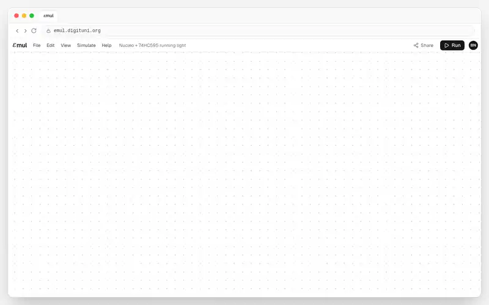

<p align="center">
  
</p>

<h3 align="center">real firmware + real circuits, in your browser</h3>

<p align="center">
  STM32 · Arduino · PIC firmware + live circuits · an open alternative to Proteus
</p>

<p align="center">
  <a href="https://emul.digituni.org/"></a>
  <a href="LICENSE"></a>
  <a href="https://github.com/ChernihivPolytechnicNationalUniversity/emul/actions"></a>
  <a href="https://github.com/ChernihivPolytechnicNationalUniversity/emul/releases"></a>
</p>

<p align="center">
  <a href="https://emul.digituni.org/"><b>Live demo</b></a> ·
  <a href="#contributing">Contributing</a>
</p>

<p align="center">
  <a href="https://emul.digituni.org/">
    
  </a>
</p>

<p align="center">
  <b><a href="https://emul.digituni.org/">▶ Try it in your browser: no install, no account</a></b><br>
</p>

---

εmul runs unmodified firmware (the exact `.elf` from STM32CubeIDE, an Arduino sketch, or a PIC
`.hex`) on an emulated Cortex-M / AVR / PIC core, and couples it to a live nonlinear model of the
circuit around it. No install, no account, no license fee: a free, open-source alternative to
Proteus that runs in a browser tab.

## Features

- **Unmodified firmware** runs on an emulated Cortex-M4/M7, ATmega328P or PIC16: drop a CubeIDE `.elf`, an AVR `.elf` or Arduino sketch, or a PIC `.hex`, with no porting.
- A **live circuit** surrounds the chip, solved as a nonlinear nodal model: timers, UART, SPI, I²C, DMA, ADC/DAC, flash, an SDRAM-backed LTDC panel, real parts with real ratings.
- Everything runs **client-side in a browser tab**. Nothing to install, no sign-up, free.
- You can **short an output, reverse polarity, or put 12 V on a GPIO** safely; it does what it does on the desk, minus the magic smoke.
- A built-in **Monaco editor and build service** compile a project the way CubeIDE and the Arduino IDE do.
- Open a bench together with **live collaboration**: share a `/r/…` link and cursors, part moves and wiring sync in real time.
- **Open source**, Apache-2.0.

<sub>Boards: STM32 F429 (Nucleo-144) · F746 (Open746I-C) · Arduino Nano (ATmega328P) · PIC16F627A/628A/648A · ESP32 in development.</sub>

## Quick start

Open [emul.digituni.org](https://emul.digituni.org), pick a sample, press **Run**. Nothing to install.

Or run it locally:

```sh
pnpm install && pnpm dev     # http://localhost:5173
pnpm test                    # bench physics, batteries, wires, reflash
```

## Contributing

15 releases in two weeks, so PRs land fast. Start with a
[**good first issue**](https://github.com/ChernihivPolytechnicNationalUniversity/emul/issues?q=is%3Aissue+is%3Aopen+label%3A%22good+first+issue%22).

---

<sub>Apache-2.0 · Copyright 2026 Bohdan Nahornyi, Denys Lysenok, Andrii Savenko · [third-party notices](THIRD_PARTY_NOTICES.md)</sub>
